# 📍 waypoints: o guia do utilizador

*Also in English: [user guide](GUIDE.md).*

Este guia mostra como usar o waypoints, passo a passo. Não precisas de ser técnico. A viagem nas
imagens, *Japão na primavera* com a Ana, o Ben e a Chloé, é inventada.

## Índice

1. [O que é o waypoints](#1-o-que-é-o-waypoints)
2. [Instalar](#2-instalar)
3. [A tua primeira viagem](#3-a-tua-primeira-viagem)
4. [Antes da viagem](#4-antes-da-viagem)
5. [Durante a viagem](#5-durante-a-viagem)
6. [Depois da viagem](#6-depois-da-viagem)
7. [Partilhar com o grupo](#7-partilhar-com-o-grupo)
8. [Manter as tuas viagens a salvo](#8-manter-as-tuas-viagens-a-salvo)
9. [Privacidade, em palavras simples](#9-privacidade-em-palavras-simples)
10. [Definições num relance](#10-definições-num-relance)
11. [Perguntas](#11-perguntas)

## 1. O que é o waypoints

O waypoints guarda as tuas viagens no telemóvel: as reservas, um plano dia a dia, os locais que queres
visitar e o dinheiro que partilhas com as pessoas com quem viajas. Não há nenhuma conta para criar, e
funciona sem internet, no avião ou na montanha.

Quando vais com outras pessoas, partilhas a viagem com elas. Cada uma guarda a sua própria cópia, e as
alterações juntam-se sozinhas.

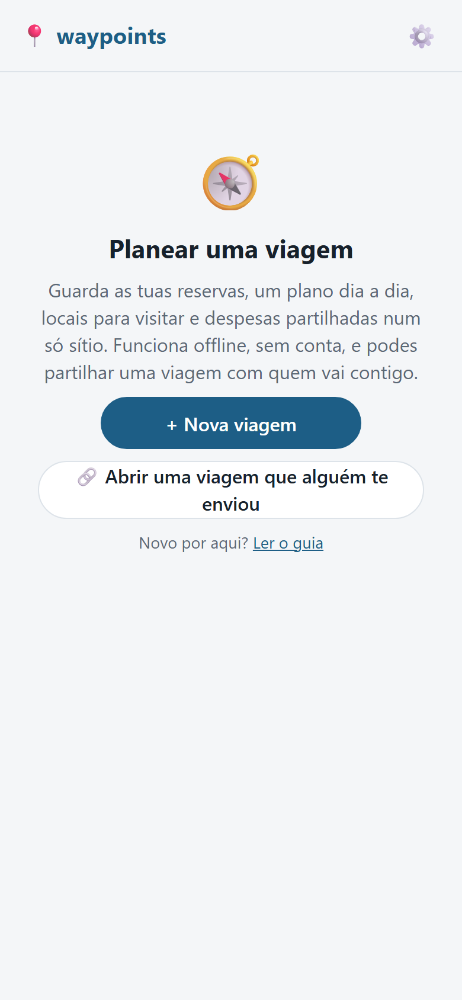

## 2. Instalar

Abre o endereço da app (está no início do [README](README.md) (em inglês)) no telemóvel e adiciona-a ao ecrã principal. Depois
abre como qualquer outra app.

- **iPhone:** abre o endereço no Safari, toca em **Partilhar** e depois em **Adicionar ao ecrã principal**.
- **Android:** abre o endereço no Chrome, toca no menu ⋮ e depois em **Adicionar ao ecrã principal** ou **Instalar app**.

Porque é que isto importa:

- A app abre offline depois de estar no ecrã principal.
- Os navegadores podem apagar os dados dos sites quando o telemóvel fica com pouco espaço. Uma app no
  ecrã principal tem muito menos probabilidade de perder os seus dados. Mantém uma cópia de segurança na mesma (vê a [secção 8](#8-manter-as-tuas-viagens-a-salvo)).

## 3. A tua primeira viagem

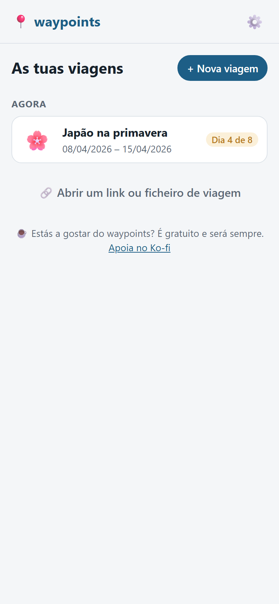

As tuas viagens aparecem aqui, em **Agora**, **Em breve** e **Viagens passadas**. Toca em **+ Nova viagem** para começar uma.

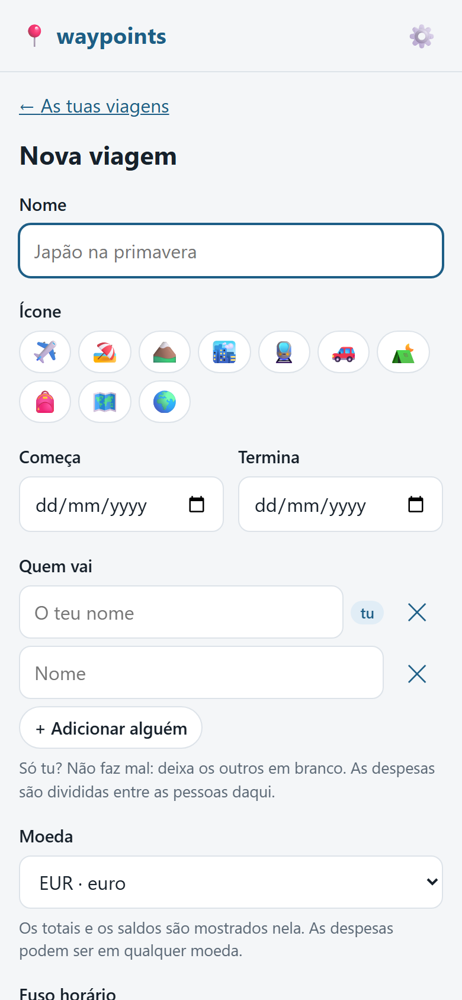

Preenche:

- o **nome** e as **datas** da viagem,
- a **moeda** em que contas (aquela em que as despesas partilhadas são somadas),
- o **fuso horário** onde a viagem acontece,
- **quem vai**. Escreve cada nome. O teu próprio nome é sugerido primeiro.

Tu és a primeira linha da lista, marcada com "tu". A app usa isso para as tuas avaliações, o que pagaste e
o que deves. Se alguém te enviar um link de viagem, pergunta qual dos viajantes és quando o abres. Um ficheiro
de viagem não pergunta: escolhe-te em **Qual deles és tu?** no separador 🧳 Viagem.

Se alguém te enviou uma viagem, toca em **🔗 Abrir uma viagem que alguém te enviou** no ecrã de boas-vindas, ou abre o
link ou o ficheiro dessa pessoa. Vê a [secção 7](#7-partilhar-com-o-grupo).

Dentro de uma viagem, **‹** no canto superior esquerdo volta um ecrã atrás. Nos cinco separadores em baixo, leva-te de volta às tuas viagens.

## 4. Antes da viagem

Uma viagem tem cinco separadores em baixo: 🗓️ Plano, 📍 Locais, 💶 Dinheiro, 📎 Ficheiros e 🧳 Viagem. A maior parte do que
planeias entra a partir do separador Plano, com **+ Estadia**, **+ Trajeto** e **+ Atividade**.

### Estadias, trajetos e atividades

- Uma **estadia** é um hotel, um apartamento ou qualquer cama para dormir, com check-in e check-out.
- Um **trajeto** é um voo, comboio, autocarro ou ferry.
- Uma **atividade** é qualquer coisa que faças: uma visita, um jantar, uma excursão.

Cada uma pode ter uma morada, um número de telefone, um link de reserva e uma **referência da reserva**. Toca numa referência
da reserva para a copiar, o que dá jeito na receção. Toca num número de telefone para ligar. Uma morada tem os botões **🧭 Direções** e
**🗺️ Google Maps**, mais **🍎 Apple Maps** no iPhone e no iPad.

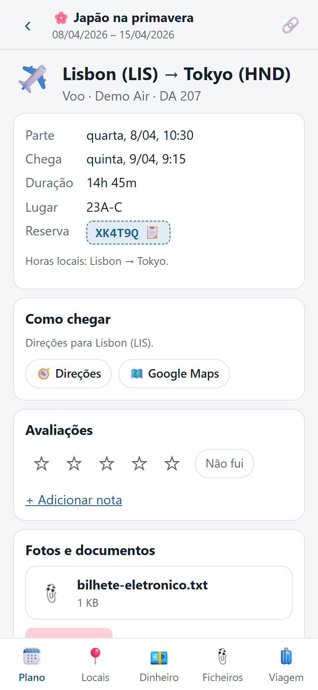

### Cidades, aeroportos e fusos horários

Começa a escrever uma cidade e escolhe-a na lista. Tem todas as localidades com 15 000 habitantes ou mais, e funciona
offline. As cidades que já usas na viagem aparecem primeiro.

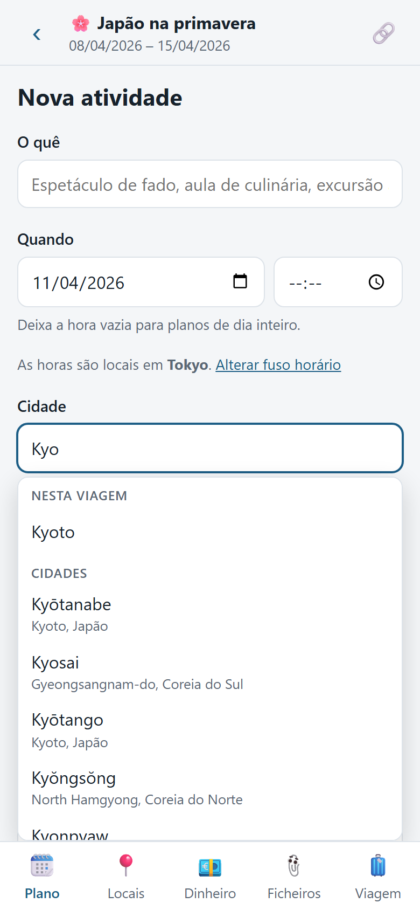

- Nos voos, escreve uma cidade, o nome de um aeroporto ou o seu código ("nrt", "heathrow"). Aparece "Tokyo (NRT)".
- Escolher uma cidade ou um aeroporto define o seu **fuso horário**. Um voo parte às 10:30 de Lisboa e chega às
  09:15 de Tóquio, e as duas horas ficam certas.
- Os teus trajetos decidem o fuso horário do que adicionas depois deles. No dia a seguir a um voo para o Japão, uma nova
  atividade fica na hora do Japão.

### Moradas

Os campos de morada sugerem as moradas que já estão na viagem, como a do teu hotel para uma atividade lá, e
preenchem também a cidade.

Podes também ativar **Pesquisar também moradas online** em Definições → **Pesquisa de moradas**. Procura qualquer morada
à medida que escreves, usando o OpenStreetMap. Precisa de internet, e o que escreves no campo da morada é enviado
para lá. Está desligada até a ativares.

### Fotos e documentos numa reserva

Em qualquer estadia, trajeto, atividade, local ou despesa, podes adicionar fotos e documentos: um bilhete, um
cartão de embarque, um recibo.

- Os documentos ficam guardados no telemóvel, por isso abrem na porta de embarque sem rede.
- Voos comprados juntos partilham uma referência da reserva. Dá a cada um a mesma referência, e um documento adicionado
  a um fica **para todos os voos dessa reserva**. Desmarca para manter um cartão de embarque só no seu voo.
- Marca **Só neste telemóvel** para guardar algo só para ti, como um passaporte. Nunca é enviado a
  ninguém, e podes partilhá-lo mais tarde.
- As fotos ficam mais pequenas quando as adicionas, o que também apaga o sítio onde foram tiradas. Os originais
  ficam na galeria do teu telemóvel.
- Os links e os ficheiros de viagem não levam fotos nem documentos. Só se partilham através de um servidor de sincronização
  (vê a [secção 7](#7-partilhar-com-o-grupo)).

### Locais para visitar

O separador 📍 Locais guarda os locais que gostavas de visitar, agrupados por cidade.

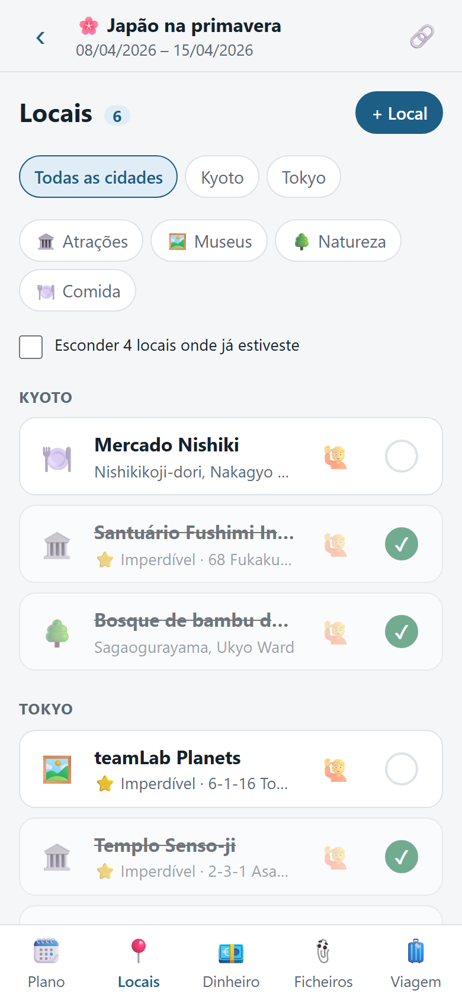

- Marca um local como **⭐ Imperdível**.
- Marca **✅ Já fui** quando o visitaste.
- Numa viagem com dois ou mais viajantes, toca em **🙋 Quero ir** num local (ou no botão 🙋 da sua linha) para
  dizer que gostavas de o ver. A linha mostra quantos querem ir, e a página do local mostra quem. Toca outra vez para
  retirar o voto. Quando algum local tiver um voto, **Mais desejados primeiro** põe no topo os locais mais desejados de cada cidade.
  Com um servidor de sincronização, é preciso atualizá-lo para a última versão para partilhar os votos.
- Toca em **🗓️ Adicionar ao plano** para transformar um local numa atividade num dia.
- Cola um link do Google Maps ou do Apple Maps para abrir o local no mapa mais tarde.
- Com um servidor de sincronização, um novo local tem uma caixa **Cola um link do Google Maps**: cola o link (no Google Maps,
  toca em Partilhar → Copiar link) e toca em **Preencher** para ficarem preenchidos o nome, o link e a cidade.
- Com um servidor de sincronização, **Importar lista** (por cima dos locais) traz uma lista partilhada do Google Maps:
  cola o link (no Google Maps, abre a lista e toca em Partilhar → Copiar link), toca em **Procurar**, marca os locais que queres e
  toca em **Adicionar**.

### Bagagem e tarefas

Cada viagem tem uma lista partilhada do que levar e do que fazer antes de partir. No separador 🧳 Viagem,
abre o cartão **🎒 Bagagem e tarefas** e toca em **Abrir a lista**. O cartão mostra quantos itens já estão na mala,
como "2 de 9 na mala".

- Escreve em **Adicionar um item** e toca em **Adicionar**. Podes adicionar o mesmo texto duas vezes, se quiseres dois.
- Toca na caixa ao lado de um item para o marcar como na mala, e toca outra vez para desmarcar. Todos no grupo veem
  as mesmas marcas. Os itens por marcar aparecem primeiro.
- Numa viagem com mais de um viajante, escolhe **Quem leva** para dizer quem o tem, ou deixa em
  "Ninguém ainda".
- Em **Adicionar a partir de um modelo**, toca em Praia, Cidade, Caminhada ou Esqui para adicionar um conjunto pronto de
  itens. Os itens que já estão na lista são ignorados, e nada é removido nem alterado.
- Toca no texto de um item para o editar, e depois em **Guardar**, **Cancelar** ou **Eliminar**. Um item eliminado desaparece para
  todos no grupo quando partilhares a viagem.
- Com um servidor de sincronização, o servidor precisa de ser atualizado para partilhar as listas. Até lá ficam no teu telemóvel, e
  os links continuam a funcionar.

### Calendário

No separador 🧳 Viagem, **📅 Descarregar calendário (.ics)** dá-te um ficheiro com todas as estadias, trajetos e atividades.
Abre-o no telemóvel para os adicionares ao Google Calendar ou ao Calendário da Apple. Descarrega-o outra vez depois de alterações: os eventos
são atualizados, não copiados duas vezes.

Uma reserva individual tem o seu próprio link **📅 Adicionar ao Google Calendar** e o seu ficheiro de calendário.

## 5. Durante a viagem

### Plano e Reservas

O separador 🗓️ Plano mostra o dia em que estás e o que vem a seguir. Diz qual é a estadia desta noite, com os botões **🧭 Direções** e
**🗺️ Google Maps**.

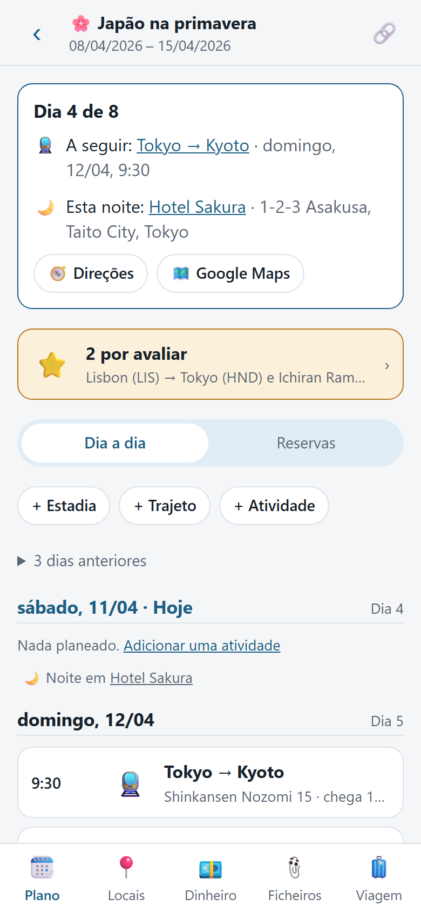

Abaixo, **Dia a dia** lista todos os dias com o sítio onde dormes nessa noite. **Reservas** lista todas as
reservas com a sua referência, para encontrares uma depressa.

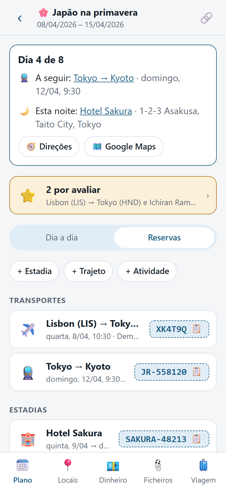

Os trajetos com a mesma referência de reserva aparecem juntos em **Ligações**, com a escala entre eles e um
aviso se não ligarem. Os trajetos com mais de um dia de intervalo, como um voo de ida e outro de volta, ficam separados.

### Despesas

No separador 💶 Dinheiro, adiciona uma despesa: o que foi, quanto, em que moeda, quem pagou e quem divide.

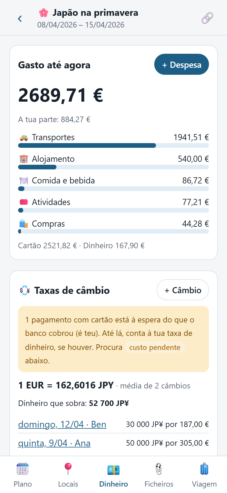

- Usa **qualquer moeda**.
- **Divide** por igual entre as pessoas que a partilham, ou por valores exatos.
- Diz se foi pago em **Dinheiro** ou com **Cartão**. Uma nova despesa começa da forma como foi paga a última
  nessa moeda.
- Adiciona uma foto do recibo à despesa.

### Câmbios e taxas de dinheiro

Regista uma só vez cada levantamento ou troca de dinheiro, por exemplo "10 000 JPY por 62,50 €", em **Taxas
de câmbio**. Todas as despesas em dinheiro nessa moeda passam então a contar à taxa que realmente obtiveste, comissões incluídas.
Com vários câmbios, as taxas fazem média.

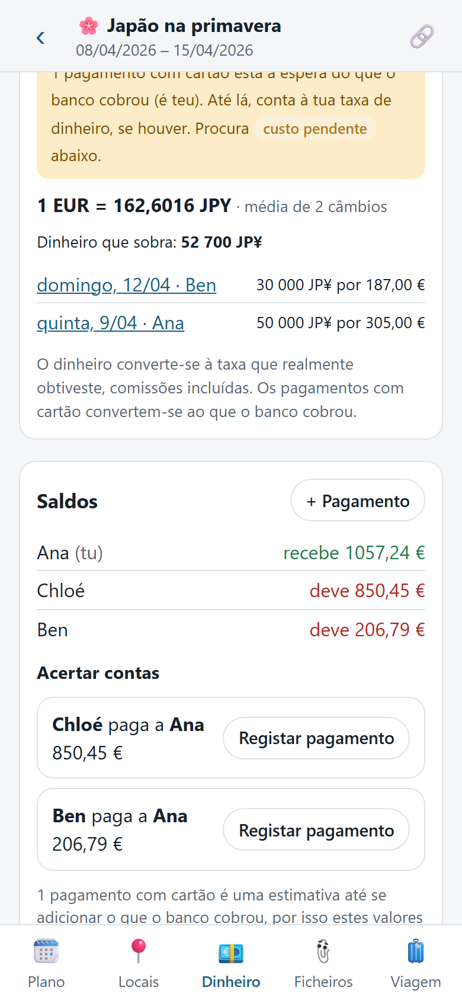

Em cada moeda estrangeira vês também o **dinheiro que sobra**: o que trocaste, menos o que gastaste em dinheiro.

### Custo pendente

Um pagamento com cartão usa o que o teu banco cobrou, que talvez ainda não vejas. Guarda a despesa sem o
valor. Fica marcada como **custo pendente**, conta à tua taxa de dinheiro entretanto, e o separador Dinheiro diz-te
quantas estão à espera, e quais são tuas. Adiciona o valor real quando o banco o mostrar.

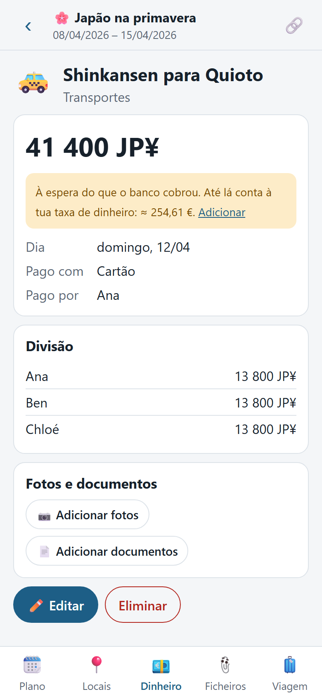

### Saldos e acerto de contas

Os saldos mostram quem deve a quem, com o menor número de pagamentos para acertar contas. Toca em **Registar pagamento** para registar
um pagamento. Abre já preenchido, por isso podes mudar o valor: deves 100 € e devolves 35 €, e ficam 65 €
por pagar. **+ Pagamento** regista qualquer outro pagamento.

### Separador Ficheiros

O separador 📎 Ficheiros tem um seletor no topo: **Documentos** (bilhetes, reservas, seguros) ou **Fotos**. Ambos
têm um título para aquilo a que os ficheiros pertencem, com a viagem inteira primeiro, depois estadias, trajetos, atividades,
locais e despesas. Cada item tem a sua própria secção sob o seu tipo. As fotos aparecem 3 por secção; toca em
**Ver todas** para ver todas as fotos desse item, por dia.

Para eliminar vários, toca em **Selecionar**, marca-os e toca em **Eliminar**. **Selecionar tudo** marca tudo o que está à vista.

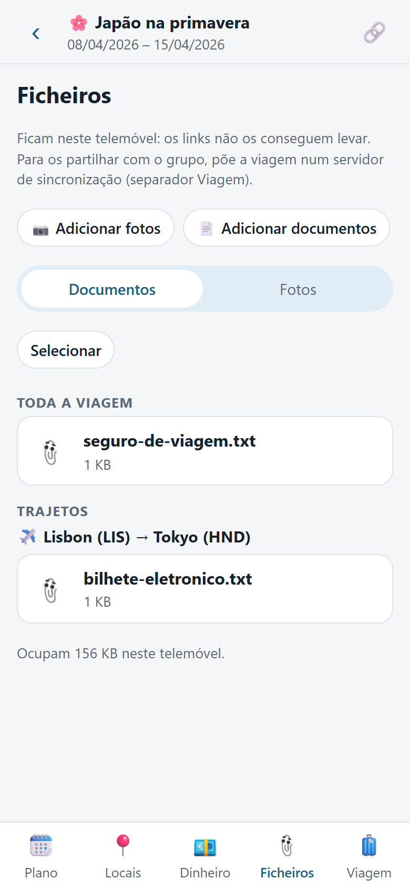

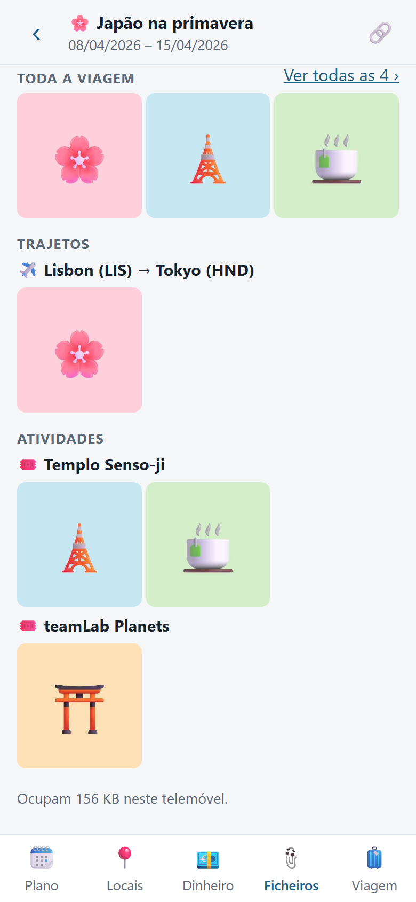

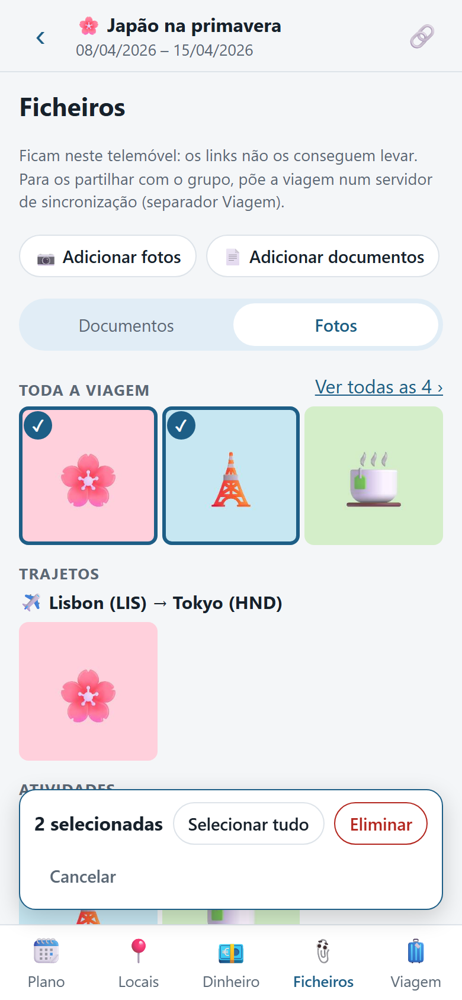

## 6. Depois da viagem

### Avaliações

Quando algo já começou, a sua página tem um cartão **Avaliações**. Os locais só o têm depois de marcados
**✅ Já fui**.

- Dá **1 a 5 estrelas** e adiciona uma nota, ou toca em **Não fui**.
- Cada pessoa escreve as suas, e aparecem lado a lado.
- Quando as coisas terminam, o separador Plano diz quantas estão **por avaliar**. Toca nisso para as avaliares
  uma a seguir à outra. Depois podes ver as avaliações de todos, as mais recentes ou as melhor avaliadas primeiro.

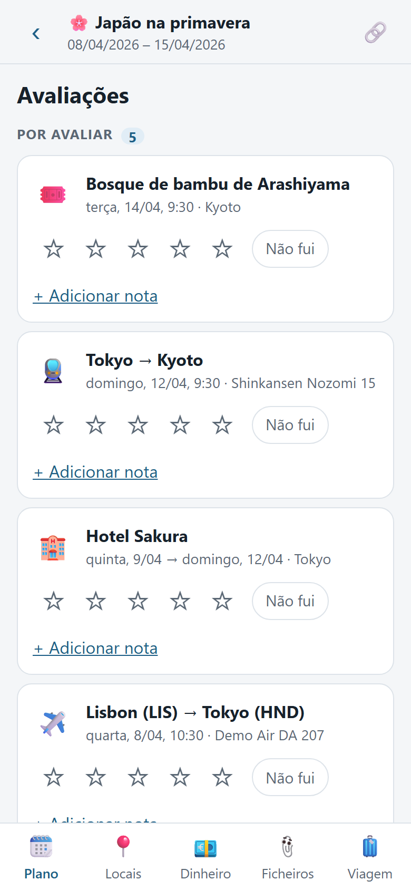

### Relatório da viagem

O relatório é a viagem inteira numa só página: quanto custou (por categoria, por dia, quem pagou o quê), se
todos já acertaram contas, o melhor e o pior da viagem com as estrelas e as notas de todos, as estadias e
os trajetos, os locais que guardaste mas nunca visitaste, uma foto por dia, e alguns números para recordar.

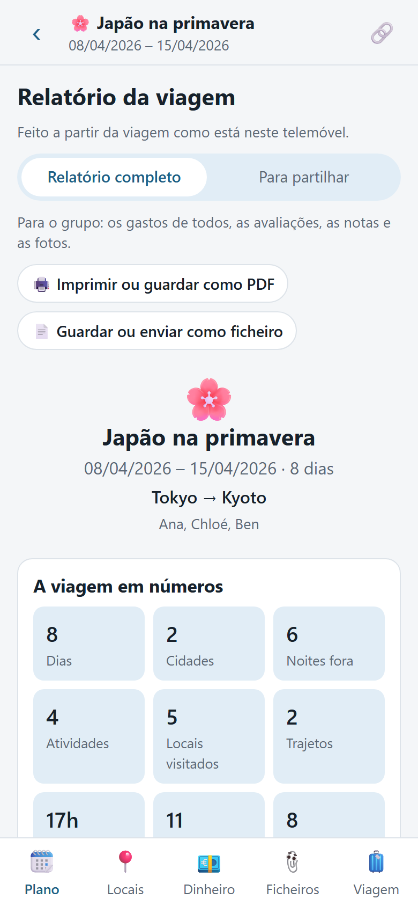

- Abre-o a partir do separador Plano quando a viagem terminar, ou do separador 🧳 Viagem para ver a viagem até agora.
- Escolhe o **Relatório completo**, para o grupo, ou o que é **Para partilhar**, para qualquer outra pessoa. O que é para partilhar deixa de fora
  nomes, notas e fotos, e quanto custou, a menos que o adiciones.
- **🖨️ Imprimir ou guardar como PDF**, ou guarda-o como um ficheiro que abre em qualquer navegador, para guardar ou enviar numa conversa.
- Numa viagem guardada num servidor de sincronização, o relatório é feito uma só vez e fica lá guardado, por isso todos abrem o mesmo.
  Se a viagem mudar depois, qualquer pessoa pode fazê-lo outra vez.

## 7. Partilhar com o grupo

Cada pessoa do grupo guarda a sua própria cópia da viagem no telemóvel. Há duas formas de a partilhar.

### Com um link ou um ficheiro

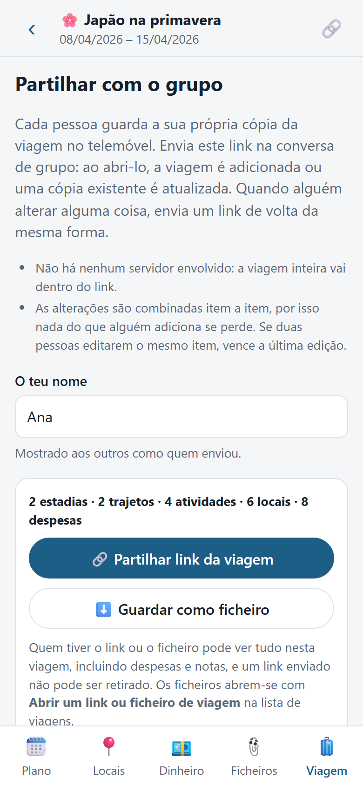

1. Na viagem, toca em 🔗. Toca em **Partilhar link da viagem** e envia o link na conversa de grupo. Ou usa
   **Guardar como ficheiro** e envia o ficheiro.
2. Abrir o link adiciona a viagem e pergunta qual dos viajantes és. Um ficheiro não pergunta: escolhe-te
   em **Qual deles és tu?** no separador 🧳 Viagem.
3. Qualquer pessoa pode adicionar coisas e enviar um link de volta da mesma forma. Abri-lo **junta** as alterações à tua
   cópia, item a item: as coisas novas são adicionadas, a edição mais recente de cada item vence, e as eliminações são
   passadas. Abrir o mesmo link duas vezes não muda nada, e os links podem chegar por qualquer ordem.

Convém saber:

- A viagem inteira vai dentro do link. Não há nenhum servidor envolvido.
- A app mostra um **ponto de lembrete** quando alteraste coisas que o grupo ainda não recebeu.
- As viagens com muita coisa fazem links compridos, e algumas apps de conversa cortam-nos. Envia antes a viagem como um ficheiro,
  e os outros abrem-no com **Abrir um link ou ficheiro de viagem** na lista de viagens.
- Quem tiver o link pode ver tudo na viagem, incluindo despesas e notas. **Um link que já foi
  enviado não pode ser retirado.**
- As fotos e os documentos não viajam em links nem em ficheiros.

### Com um servidor de sincronização

Se alguém que conheces tem um **servidor de sincronização** waypoints (num computador em casa, por exemplo), as alterações chegam a
todos sozinhas, sem links, e as fotos e os documentos também são partilhados. Entras como viajante:

1. A pessoa que o gere toca em **+ Convidar alguém** nas Definições e envia-te um link de convite.
2. Abre o link. Ele preenche o servidor e pergunta o teu nome.
3. Quando fizeres uma viagem, escolhe guardá-la **no servidor**, e marca as pessoas que vão. Para uma viagem que já
   tenhas, usa **🌐 Pôr no servidor** no separador Viagem.
4. As alterações feitas offline esperam no teu telemóvel e seguem na próxima vez que o servidor estiver acessível.
5. Para sair de uma viagem, usa **Sair da viagem** no separador Viagem. A viagem fica com os outros, com as tuas
   despesas.

O servidor também lê links do Google Maps para quem o usa, para preencher novos locais.

Uma viagem no servidor só é vista pelas pessoas que estão nela. Os links continuam a funcionar ao lado dele, também para pessoas que
não estão no servidor. Para gerires um servidor tu próprio, vê o [server/README.md](server/README.md) (em inglês).

## 8. Manter as tuas viagens a salvo

As tuas viagens vivem no teu telemóvel, e às vezes essa é a única cópia.

- **Cópia de segurança:** em Definições → **Cópia de segurança e transferência**, toca em **⬇️ Exportar todas as viagens** para guardar um ficheiro. Para o usar noutro
  telemóvel, ou para recuperar coisas, toca em **⬆️ Importar um ficheiro** aí. A importação junta, por isso importar o
  mesmo ficheiro duas vezes não muda nada. As fotos e os documentos não vão no ficheiro, só os nomes e as legendas.
- **Cópias de salvaguarda:** antes de removeres uma viagem, ou de a substituíres pelas alterações de outra pessoa, a app guarda uma
  cópia automaticamente. Encontra-as em **Cópias de salvaguarda** no mesmo cartão. Descarrega uma e importa-a para
  recuperares tudo.
- **Remover uma viagem deste telemóvel:** o separador 🧳 Viagem tem **Remover deste telemóvel**. Só elimina a
  viagem deste telemóvel. Os outros ficam com a cópia deles. Fica uma cópia de salvaguarda.
- **O navegador a apagar dados:** pode fazê-lo quando o espaço escasseia, sobretudo no iPhone. Adiciona a app ao teu
  ecrã principal e, em Definições → **Armazenamento**, toca em **Pedir armazenamento persistente**. Exporta uma cópia de segurança de vez
  em quando, mesmo assim.

## 9. Privacidade, em palavras simples

- **No teu telemóvel:** as tuas viagens, fotos e documentos, e o teu nome. Não há contas, nem
  análises, nem anúncios.
- **Só se usares um link ou um ficheiro:** tudo o que enviares na conversa vai com ele, e todos os que o recebem
  podem ler a viagem inteira.
- **Só se te ligares a um servidor de sincronização:** as viagens que puseres nele vão para esse servidor, que pertence à
  pessoa que o gere. Essa pessoa pode ler o que lá está. As viagens ficam escondidas das outras pessoas no mesmo
  servidor, não de quem o gere. As fotos e os documentos marcados como **Só neste telemóvel** nunca saem.
- **Só se ativares a pesquisa de moradas online:** o que escreves num campo de morada é enviado ao Photon,
  uma pesquisa gratuita do OpenStreetMap. Pesquisar cidades e aeroportos nunca sai do teu telemóvel.
- Os mapas, os calendários e os sites de reservas são links normais. Abrem nas suas próprias apps quando lhes tocas.

Sem um servidor de sincronização e sem pesquisa de moradas online, a app não faz nenhum pedido à internet.

## 10. Definições num relance

Abre as Definições a partir da lista de viagens. Tem estes cartões:

- **O teu nome:** sugerido como primeiro viajante nas viagens novas. Fica no teu telemóvel.
- **Idioma:** Automático segue o idioma do telemóvel; ou escolhe English ou Português. Fica no teu telemóvel.
- **Pesquisa de moradas:** liga ou desliga a pesquisa de moradas online.
- **Servidor de sincronização:** liga a um servidor waypoints, com um convite ou como a pessoa que o gere.
- **Cópia de segurança e transferência:** exporta e importa as tuas viagens, e as tuas cópias de salvaguarda.
- **Armazenamento:** quanto espaço o waypoints usa, e o armazenamento persistente.
- **Atualizações:** **✨ Novidades** mostra o que mudou em cada versão.
- **Acerca de:** a versão, um link para este guia, e a página do projeto.

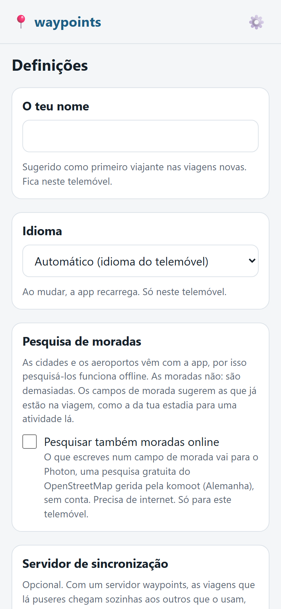

O waypoints atualiza-se sozinho: uma nova versão é apanhada da próxima vez que abrires a app, e as tuas viagens
nunca são tocadas por uma atualização. Se a app já estiver aberta, um aviso diz "Está pronta uma nova versão do waypoints":
toca em **Recarregar** para atualizar já, ou em **Mais tarde**.

## 11. Perguntas

**Duas pessoas mudaram a mesma coisa. Qual vence?**
A edição mais recente. Tudo o resto é mantido: nada do que alguém adicionou se perde quando as alterações se juntam.

**Estou offline. Funciona?**
Sim. Tudo funciona sem internet, incluindo a pesquisa de cidades e aeroportos. Com um servidor de sincronização, as tuas
alterações esperam no telemóvel e seguem quando o servidor estiver acessível.

**O meu link foi cortado na conversa.**
As viagens compridas fazem links compridos, e algumas apps de conversa cortam-nos. Usa **Guardar como ficheiro** no ecrã de partilha,
envia o ficheiro, e pede aos outros que o abram com **Abrir um link ou ficheiro de viagem**.

**Perdi o meu telemóvel.**
Se a viagem estiver num servidor de sincronização, pede à pessoa que o gere (ou usa outro dos teus telemóveis) um
**link de acesso**. Ele traz o telemóvel novo de volta como a mesma pessoa, com todas as tuas viagens. Não entres outra vez
como membro novo: isso seria outra pessoa, que não as vê. O telemóvel perdido também pode ser desligado aí.
Caso contrário, pede a alguém do grupo que te envie um link, ou importa um ficheiro de cópia de segurança, se tiveres um. É por isso que vale a pena fazer uma cópia de vez
em quando.

**Como recebo as atualizações?**
Não tens de fazer nada. Uma nova versão é apanhada da próxima vez que abrires a app. Se já estiver
aberta, um aviso oferece **Recarregar** ou **Mais tarde**. Em Definições →
**✨ Novidades** vês o que mudou.

**Posso usá-lo só com uma pessoa, ou só para mim?**
Sim. Adiciona apenas a ti como viajante, e ignora a partilha.

**Posso retirar um link que enviei?**
Não. Quem tiver o link pode ler essa viagem. Partilha links só com pessoas em quem confiarias para isso.
